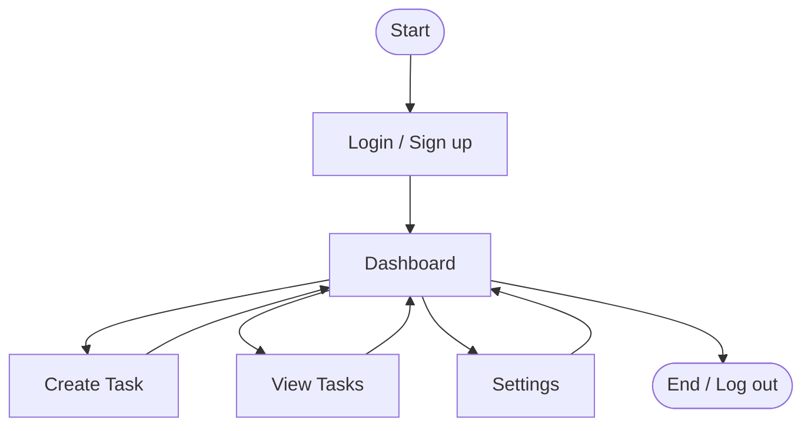
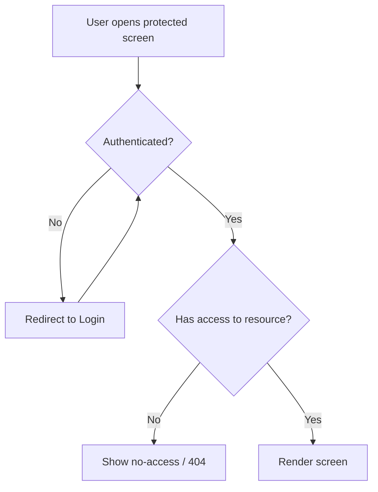

# App Flow

> **Maps the user journey.** Shows screens and decisions, and clarifies
> navigation. This is the map an AI agent follows to know which screen leads
> where and what each state transition requires.

- **Product name:** _<Product / project name>_
- **Last updated:** _<YYYY-MM-DD>_
- **Related docs:** [PRD](./PRD.md) · [Design Brief](./DESIGN-BRIEF.md) · [TRD](./TRD.md)

---

## 1. Flow Overview

A single diagram of the primary path through the app, start to finish. This is
the "happy path" an average user takes.

> This mirrors the reference flow: **Start → Login → Dashboard →
> (Create Task | View Tasks | Settings) → End.**

---

## 2. Screens / States

List every screen, its purpose, what the user can do there, and where each
action leads. Keep screen names consistent with the [Design Brief](./DESIGN-BRIEF.md).

| Screen | Purpose | Entry from | Key actions | Leads to |
|--------|---------|-----------|-------------|----------|
| **Login / Sign up** | Authenticate | App launch | log in, sign up, reset password | Dashboard |
| **Dashboard** | Home / overview | Login | open project, create task, navigate | Create / View / Settings |
| **Create Task** | Add a new task | Dashboard | fill form, save, cancel | Dashboard (task added) |
| **View Tasks** | Browse / manage tasks | Dashboard | filter, open task, change status, comment | Task detail |
| **Task Detail** | Single task view | View Tasks | edit, assign, comment, delete | View Tasks |
| **Settings** | Account / preferences | Dashboard | update profile, log out | Dashboard / Login |

---

## 3. Decision Points

Where the flow branches based on state or user choice. Define the condition and
both outcomes.

- **Is the user authenticated?**
  - Yes → Dashboard
  - No → Login (then return to the originally requested screen)
- **Is the form valid on Create Task?**
  - Yes → save, return to Dashboard with the new task visible
  - No → stay on form, show inline validation errors
- **Does the user own / have access to the resource?**
  - Yes → allow
  - No → show "not found" / "no access"

---

## 4. Navigation Model

- **Primary navigation:** _<e.g., persistent sidebar: Dashboard, Projects, Settings>_
- **Secondary navigation:** _<e.g., tabs within a project: Tasks, Comments>_
- **Global elements:** _<top bar with user menu, search, notifications>_
- **Back / cancel behavior:** _<where "cancel" and browser-back lead>_
- **Deep links:** _<which screens are directly addressable by URL>_

---

## 5. Key User Flows (step by step)

Spell out the critical journeys as numbered steps, including error branches.

### Flow A — First-time user creates their first task
1. User lands on **Login**, chooses **Sign up**.
2. Submits valid details → account created → redirected to **Dashboard** (empty state).
3. Clicks **Create Task** → fills title, picks project, saves.
4. Returns to **Dashboard**; the new task appears in **View Tasks**.
   - *Error branch:* invalid form → inline errors, user stays on the form.

### Flow B — Returning user updates a task status
1. User logs in → **Dashboard**.
2. Opens **View Tasks** → selects a task → **Task Detail**.
3. Changes status `todo → in_progress` → saved → list reflects the change.

---

### How the AI agent should use this doc
1. Implement navigation and guards exactly as in §3–§4 (auth checks, access checks).
2. Every screen in §2 should exist and route correctly before polishing UI.
3. Build the **happy path (§1)** first, then handle decision branches and errors.
4. Keep screen names aligned with the [Design Brief](./DESIGN-BRIEF.md) and data
   with the [Database Schema](./DATABASE-SCHEMA.md).
