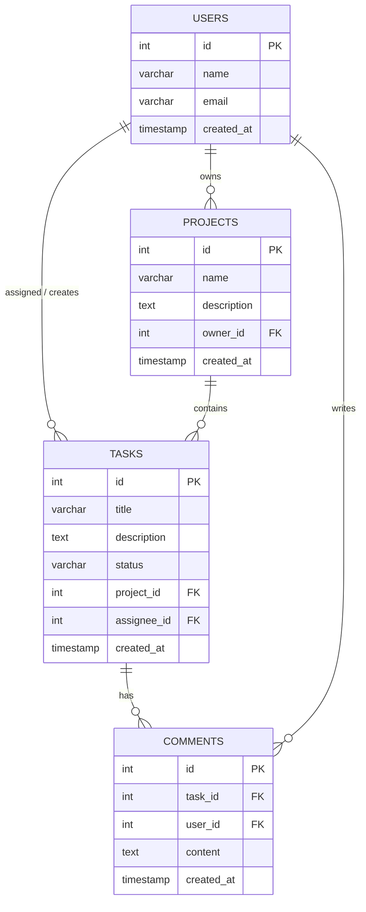

# Database Schema

> **Structures the data.** Defines tables and the links between them, and
> supports the backend. This is the single source of truth for data shape —
> the [TRD](./TRD.md) APIs and [App Flow](./APP-FLOW.md) screens must stay
> consistent with it.

- **Product name:** _<Product / project name>_
- **Database:** _<e.g., PostgreSQL 16>_
- **Last updated:** _<YYYY-MM-DD>_
- **Related docs:** [TRD](./TRD.md) · [PRD](./PRD.md)

---

## 1. Entity-Relationship Diagram



> This matches the reference schema: **users (1) → (N) projects**,
> **users (1) → (N) tasks**, **projects (1) → (N) tasks**, and
> **tasks (1) → (N) comments**.

---

## 2. Tables

For each table: columns, types, constraints, and notes. Adapt types to your
chosen database.

### `users`
| Column | Type | Constraints | Notes |
|--------|------|-------------|-------|
| id | INT / SERIAL | PK, auto-increment | |
| name | VARCHAR(255) | NOT NULL | |
| email | VARCHAR(255) | NOT NULL, UNIQUE | login identifier |
| password_hash | VARCHAR(255) | NOT NULL | never store plaintext |
| created_at | TIMESTAMP | DEFAULT now() | |

### `projects`
| Column | Type | Constraints | Notes |
|--------|------|-------------|-------|
| id | INT / SERIAL | PK | |
| name | VARCHAR(255) | NOT NULL | |
| description | TEXT | NULL | |
| owner_id | INT | FK → users(id) | project owner |
| created_at | TIMESTAMP | DEFAULT now() | |

### `tasks`
| Column | Type | Constraints | Notes |
|--------|------|-------------|-------|
| id | INT / SERIAL | PK | |
| title | VARCHAR(255) | NOT NULL | |
| description | TEXT | NULL | |
| status | VARCHAR(20) | NOT NULL, DEFAULT `'todo'` | `todo` \| `in_progress` \| `done` |
| project_id | INT | FK → projects(id), NOT NULL | parent project |
| assignee_id | INT | FK → users(id), NULL | assigned user |
| created_at | TIMESTAMP | DEFAULT now() | |

### `comments`
| Column | Type | Constraints | Notes |
|--------|------|-------------|-------|
| id | INT / SERIAL | PK | |
| task_id | INT | FK → tasks(id), NOT NULL | parent task |
| user_id | INT | FK → users(id), NOT NULL | author |
| content | TEXT | NOT NULL | |
| created_at | TIMESTAMP | DEFAULT now() | |

---

## 3. Relationships

| From | To | Type | On delete |
|------|-----|------|-----------|
| users → projects | owner_id | one-to-many | restrict / reassign |
| users → tasks | assignee_id | one-to-many | set null |
| projects → tasks | project_id | one-to-many | cascade |
| tasks → comments | task_id | one-to-many | cascade |
| users → comments | user_id | one-to-many | restrict |

---

## 4. Indexes & Constraints

- **Unique:** `users.email`.
- **Indexes:** foreign keys (`projects.owner_id`, `tasks.project_id`,
  `tasks.assignee_id`, `comments.task_id`), and any frequently filtered column
  (`tasks.status`).
- **Enums / checks:** constrain `tasks.status` to the allowed set.

---

## 5. Example DDL (reference)

```sql
CREATE TABLE users (
  id          SERIAL PRIMARY KEY,
  name        VARCHAR(255) NOT NULL,
  email       VARCHAR(255) NOT NULL UNIQUE,
  password_hash VARCHAR(255) NOT NULL,
  created_at  TIMESTAMP NOT NULL DEFAULT now()
);

CREATE TABLE projects (
  id          SERIAL PRIMARY KEY,
  name        VARCHAR(255) NOT NULL,
  description TEXT,
  owner_id    INT NOT NULL REFERENCES users(id),
  created_at  TIMESTAMP NOT NULL DEFAULT now()
);

CREATE TABLE tasks (
  id          SERIAL PRIMARY KEY,
  title       VARCHAR(255) NOT NULL,
  description TEXT,
  status      VARCHAR(20) NOT NULL DEFAULT 'todo'
              CHECK (status IN ('todo','in_progress','done')),
  project_id  INT NOT NULL REFERENCES projects(id) ON DELETE CASCADE,
  assignee_id INT REFERENCES users(id) ON DELETE SET NULL,
  created_at  TIMESTAMP NOT NULL DEFAULT now()
);

CREATE TABLE comments (
  id          SERIAL PRIMARY KEY,
  task_id     INT NOT NULL REFERENCES tasks(id) ON DELETE CASCADE,
  user_id     INT NOT NULL REFERENCES users(id),
  content     TEXT NOT NULL,
  created_at  TIMESTAMP NOT NULL DEFAULT now()
);
```

---

### How the AI agent should use this doc
1. This schema is the **source of truth** for data shape — match it in models,
   migrations, and API payloads.
2. Keep API field names in the [TRD](./TRD.md) consistent with these columns.
3. Enforce constraints (FKs, uniqueness, status enum) at the database level, not
   just in application code.
4. When the PRD adds a feature needing new data, update **this doc first**, then
   the migration.
