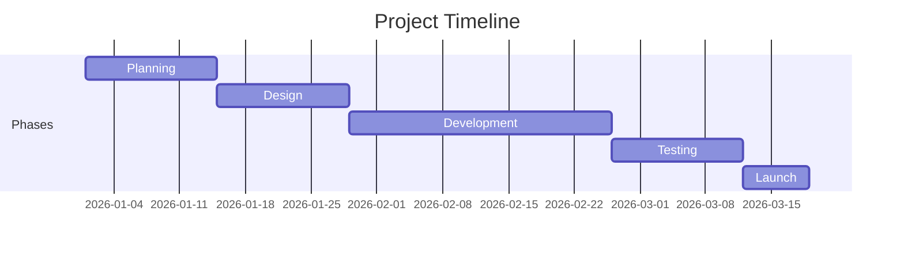

# Implementation Plan

> **Turns the plan into action.** Breaks work into phases and tracks the
> timeline and delivery. This is the execution roadmap that sequences everything
> in the other docs into shippable steps.

- **Product name:** _<Product / project name>_
- **Owner:** _<Name>_
- **Last updated:** _<YYYY-MM-DD>_
- **Related docs:** [PRD](./PRD.md) · [TRD](./TRD.md) · [App Flow](./APP-FLOW.md) · [Database Schema](./DATABASE-SCHEMA.md) · [Design Brief](./DESIGN-BRIEF.md)

---

## 1. Phases

Work is organized into five phases. Each phase has a goal, concrete tasks, and a
"done" definition.

### 1 · Planning
- **Goal:** lock scope and inputs before building.
- **Tasks:**
  - [ ] Finalize [PRD](./PRD.md) (goals, P0 features, non-goals).
  - [ ] Finalize [TRD](./TRD.md) (stack, architecture, APIs, NFRs).
  - [ ] Finalize [Database Schema](./DATABASE-SCHEMA.md).
  - [ ] Agree success metrics and MVP scope.
- **Done when:** all planning docs are `Approved`.

### 2 · Design
- **Goal:** define look, feel, and flows.
- **Tasks:**
  - [ ] Complete [Design Brief](./DESIGN-BRIEF.md) (palette, type, components).
  - [ ] Complete [App Flow](./APP-FLOW.md) and key-screen wireframes.
  - [ ] Review designs against the PRD.
- **Done when:** key screens and flows are signed off.

### 3 · Development
- **Goal:** build the product to spec.
- **Tasks:**
  - [ ] Project scaffold, environments, CI.
  - [ ] Database + migrations from the schema.
  - [ ] Auth (signup/login/logout).
  - [ ] P0 features from the PRD, screen by screen (App Flow order).
  - [ ] API endpoints per the TRD.
- **Done when:** all P0 features implemented behind passing tests.

### 4 · Testing
- **Goal:** verify it works and meets NFRs.
- **Tasks:**
  - [ ] Unit + integration tests for core flows.
  - [ ] Manual QA of each App Flow path (happy + error branches).
  - [ ] Accessibility and performance checks (TRD §5 NFRs).
  - [ ] Bug triage and fixes.
- **Done when:** acceptance criteria pass; no open P0/P1 bugs.

### 5 · Launch
- **Goal:** ship and confirm health.
- **Tasks:**
  - [ ] Production deploy + config/secrets.
  - [ ] Smoke test in production.
  - [ ] Enable analytics for success metrics.
  - [ ] Monitoring/alerts on; rollback plan ready.
- **Done when:** live, verified, and metrics are being collected.

---

## 2. Project Timeline

Adjust durations to your team. Example timeline from the reference card:

| Phase | Window | Key deliverable |
|-------|--------|-----------------|
| Planning | Week 1–2 | Approved PRD / TRD / Schema |
| Design | Week 3–4 | Signed-off screens & flows |
| Development | Week 5–8 | Working P0 features |
| Testing | Week 9–10 | Passing QA, NFRs met |
| Launch | Week 11 | Live in production |

---

## 3. Milestones & Deliverables

| Milestone | Target date | Deliverable | Depends on |
|-----------|-------------|-------------|------------|
| M1 — Docs approved | _<date>_ | PRD/TRD/Schema signed off | Planning |
| M2 — Design locked | _<date>_ | Key screens + flows | M1 |
| M3 — Feature complete | _<date>_ | All P0 built | M2 |
| M4 — QA passed | _<date>_ | Tested, NFRs met | M3 |
| M5 — Launched | _<date>_ | Production release | M4 |

---

## 4. Dependencies & Risks

- **Dependencies:** _<external services, approvals, data, third-party keys>_
- **Risks:** _<risk → impact → mitigation / owner>_
- **Assumptions:** _<team size, availability, no major scope change>_

---

## 5. Roles & Ownership

| Area | Owner |
|------|-------|
| Product / PRD | _<name>_ |
| Technical / TRD | _<name>_ |
| Design | _<name>_ |
| Development | _<name>_ |
| QA / Testing | _<name>_ |

---

### How the AI agent should use this doc
1. Work **phase by phase**; don't start Development until Planning/Design inputs
   exist (or are explicitly stubbed).
2. Within Development, follow **App Flow order** and build P0 before P1/P2.
3. Treat each phase's **"Done when"** as a gate — verify before moving on.
4. Keep the checklists updated as work completes so status stays accurate.
