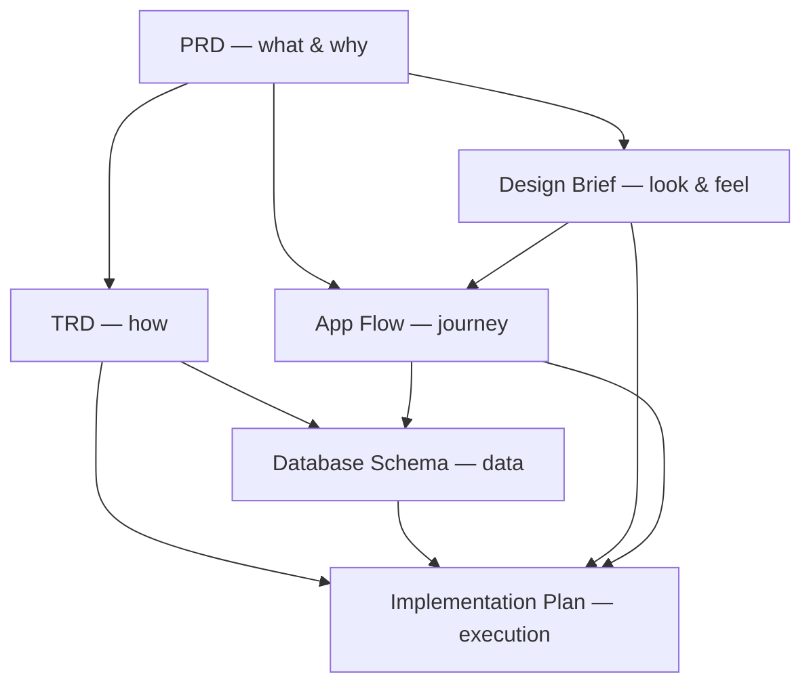

# Technical Guide

> **How to use this document set.** The other six docs describe *what* and *how*
> to build. This guide ties them together: the order of operations, how an AI
> coding agent should consume them, and the conventions that keep everything
> consistent.

- **Last updated:** _<YYYY-MM-DD>_

---

## 1. The Document Set

Seven documents power an AI-assisted coding workflow. Together they form the
"context pack" you hand to an AI agent before it writes a line of code.

| # | Document | Answers | Role |
|---|----------|---------|------|
| 1 | [PRD](./PRD.md) | **What** to build | Product requirements: goals, users, features, metrics |
| 2 | [TRD](./TRD.md) | **How** to build | Technical requirements: architecture, stack, APIs, NFRs |
| 3 | [App Flow](./APP-FLOW.md) | **Where** users go | Screens, navigation, decision points |
| 4 | [Database Schema](./DATABASE-SCHEMA.md) | **What data** | Tables, columns, relationships |
| 5 | [Design Brief](./DESIGN-BRIEF.md) | **How it looks** | Brand, color, type, key screens |
| 6 | [Implementation Plan](./IMPLEMENTATION-PLAN.md) | **When / in what order** | Phases, timeline, milestones |
| 7 | **Technical Guide** (this doc) | **How to use them together** | Workflow, conventions, agent instructions |

---

## 2. How They Fit Together

- The **PRD** is the root — everything traces back to it.
- The **TRD**, **Design Brief**, and **App Flow** translate the PRD into
  technical, visual, and navigational specs.
- The **Database Schema** is the data source of truth, referenced by both the
  TRD (APIs) and the App Flow (what each screen reads/writes).
- The **Implementation Plan** sequences all of the above into shippable phases.

---

## 3. Recommended Order of Operations

1. **Write the PRD first.** Lock goals, personas, P0 features, and non-goals.
2. **Write the TRD and Database Schema together.** The data model and the API
   contract inform each other.
3. **Write the Design Brief and App Flow.** Visual direction and navigation,
   grounded in the PRD's features and the schema's data.
4. **Write the Implementation Plan.** Only once the above exist, so phases map to
   real, agreed scope.
5. **Run the design phase.** Load `skills/design-phase/SKILL.md`, fill the screen
   map and component inventory from `templates/design-phase/`, build static
   screens, and get a signed `DESIGN-APPROVAL.md`.
6. **Hand the full set to the AI agent** and build phase by phase.

> **Rule of thumb:** no code before the PRD, TRD, and Schema are at least in
> `Draft`, internally consistent, and the design is signed off.

---

## 4. Conventions

Keep these consistent across all docs so the agent never has to guess.

- **Naming:** one canonical name per entity, screen, and feature. If the PRD says
  "task," the schema table is `tasks`, the API is `/tasks`, and the screen is
  "View Tasks" — never synonyms.
- **IDs:** features get stable IDs (`F1`, `F2`…); endpoints and screens reference
  those IDs.
- **Status fields:** every doc has `Draft` / `In Review` / `Approved` and a
  `Last updated` date.
- **Cross-links:** link between docs with relative Markdown links (as used here).
- **Single source of truth:** data shape lives in the Schema; API shape in the
  TRD; visual tokens in the Design Brief. Don't duplicate — link.
- **Change flow:** when scope changes, update the **PRD first**, then propagate
  down to the affected docs before touching code.

---

## 5. Using This Set with an AI Coding Agent

**Prime the agent** by giving it all seven docs (or pointing it at this folder)
at the start of a build session.

Suggested kickoff prompt:

> "Read `TECHNICAL-GUIDE.md` first, then `PRD.md`, `TRD.md`,
> `DATABASE-SCHEMA.md`, `APP-FLOW.md`, `DESIGN-BRIEF.md`, and
> `IMPLEMENTATION-PLAN.md`. Build according to the Implementation Plan, phase by
> phase. Follow the TRD stack and the Database Schema exactly. Before feature
> code, run `skills/design-phase/SKILL.md` and stop at a signed
> `DESIGN-APPROVAL.md`. Ask before deviating from any P0 requirement or non-goal."

What the agent should do:
1. **Respect the contract:** P0 features (PRD) + pinned stack (TRD) + schema are
   non-negotiable unless told otherwise.
2. **Honor non-goals:** don't build what the PRD excludes.
3. **Pass the design gate:** run `design-phase`, produce the screen map, token
   set, component inventory and static screens, and wait for a signed
   `DESIGN-APPROVAL.md`.
4. **Build in order:** follow the Implementation Plan phases and App Flow order.
5. **Verify at phase gates:** use each phase's "Done when" criteria.
6. **Surface conflicts:** if two docs disagree, flag it instead of guessing.

---

## 6. Maintenance

- Review the doc set at the start of each phase and after any scope change.
- Keep `Last updated` and `Status` current.
- When the build reveals a wrong assumption, fix the doc, not just the code —
  the docs must stay the source of truth.

---

## 7. Checklist Before Building

- [ ] PRD approved (goals, P0 features, non-goals clear).
- [ ] TRD approved (stack pinned, APIs defined, NFRs set).
- [ ] Database Schema matches TRD APIs and PRD features.
- [ ] App Flow covers every PRD feature's screens + error branches.
- [ ] Design Brief defines palette, type, and key-screen layouts.
- [ ] `design-phase` screen map, component inventory and static screens are complete.
- [ ] `DESIGN-APPROVAL.md` is signed (no feature code before this).
- [ ] Implementation Plan phases map to agreed scope with owners and dates.
- [ ] All docs cross-link and use consistent names/IDs.
