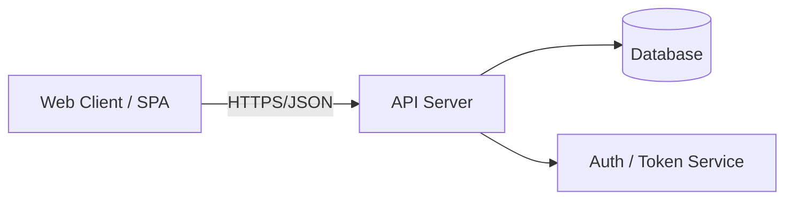

# Technical Requirements Document (TRD)

> **Defines how to build.** Covers the stack and architecture, and sets the
> technical constraints. This is the engineering blueprint that turns the
> [PRD](./PRD.md)'s *what* into an implementable *how*.

- **Product name:** _<Product / project name>_
- **Author / owner:** _<Name>_
- **Status:** `Draft` | `In Review` | `Approved`
- **Last updated:** _<YYYY-MM-DD>_
- **Related docs:** [PRD](./PRD.md) · [Database Schema](./DATABASE-SCHEMA.md) · [App Flow](./APP-FLOW.md) · [Implementation Plan](./IMPLEMENTATION-PLAN.md)

---

## 1. System Overview

A high-level description of the system: the major pieces and how they fit
together. Include a simple diagram (ASCII or Mermaid) of the components.

> **Example**
> ```
> [ Browser / SPA ] → [ API server ] → [ Database ]
>                           ↓
>                     [ Auth service ]
> ```
> *TaskFlow is a client–server web app: a single-page frontend talks to a REST
> API, which persists data in a relational database. Authentication is handled
> by JWT-based sessions.*



---

## 2. Architecture

Describe the architectural style and the responsibilities of each layer.

- **Pattern:** _<e.g., layered monolith, modular monolith, microservices, serverless>_
- **Frontend:** _<SPA / SSR, component structure, state management>_
- **Backend:** _<API style — REST / GraphQL / RPC; controller–service–repository layers>_
- **Data layer:** _<ORM / query builder, migrations, connection pooling>_
- **Boundaries:** _<what is a hard boundary vs. an internal module>_

> **Example** — *Modular monolith. Backend organized as `routes → services →
> repositories`. Frontend is a component-based SPA with a central store for
> auth/user state and per-page data fetching. A single database with migrations
> managed in version control.*

---

## 3. Tech Stack

The concrete technologies, with versions and the reason each was chosen. Pin
versions so the AI agent and the team build against the same targets.

| Layer | Technology | Version | Why |
|-------|------------|---------|-----|
| Language | _<e.g., TypeScript>_ | _<5.x>_ | _<type safety across stack>_ |
| Frontend | _<e.g., React + Vite>_ | _<…>_ | _<…>_ |
| Styling | _<e.g., Tailwind CSS>_ | _<…>_ | _<…>_ |
| Backend | _<e.g., Node.js + Express>_ | _<…>_ | _<…>_ |
| Database | _<e.g., PostgreSQL>_ | _<…>_ | _<relational data, relationships>_ |
| ORM / data | _<e.g., Prisma>_ | _<…>_ | _<…>_ |
| Auth | _<e.g., JWT / session cookies>_ | _<…>_ | _<…>_ |
| Hosting | _<e.g., Vercel + managed Postgres>_ | — | _<…>_ |
| Tooling | _<linter, formatter, test runner>_ | _<…>_ | _<…>_ |

---

## 4. APIs

Define the external contract. For each endpoint: method, path, auth requirement,
request shape, response shape, and error cases. Keep this consistent with the
[Database Schema](./DATABASE-SCHEMA.md).

### Conventions
- **Base URL:** _<e.g., /api/v1>_
- **Format:** JSON request/response, `camelCase` fields.
- **Auth:** _<e.g., `Authorization: Bearer <token>`>_
- **Errors:** _<standard shape, e.g., `{ "error": { "code", "message" } }`>_

### Endpoints

| Method | Path | Auth | Description |
|--------|------|------|-------------|
| POST | `/auth/signup` | No | Create account |
| POST | `/auth/login` | No | Obtain token |
| GET | `/projects` | Yes | List the user's projects |
| POST | `/projects` | Yes | Create a project |
| GET | `/projects/:id/tasks` | Yes | List tasks in a project |
| POST | `/tasks` | Yes | Create a task |
| PATCH | `/tasks/:id` | Yes | Update task (status, assignee, …) |
| POST | `/tasks/:id/comments` | Yes | Add a comment |

> **Example — `POST /tasks`**
> ```http
> POST /api/v1/tasks
> Authorization: Bearer <token>
> Content-Type: application/json
>
> { "projectId": 12, "title": "Write docs", "description": "...", "assigneeId": 3 }
> ```
> **201 Created**
> ```json
> { "id": 88, "projectId": 12, "title": "Write docs", "status": "todo",
>   "assigneeId": 3, "createdAt": "2026-10-13T10:00:00Z" }
> ```
> **Errors:** `400` invalid body · `401` missing/invalid token · `404` project not found.

---

## 5. Non-Functional Requirements (NFRs)

The technical constraints and quality bars the system must meet.

| Category | Requirement |
|----------|-------------|
| **Performance** | _<e.g., p95 API response < 300ms; first paint < 2s>_ |
| **Security** | _<hashed passwords (bcrypt/argon2), input validation, authz on every endpoint, HTTPS only>_ |
| **Scalability** | _<target concurrent users; stateless API for horizontal scaling>_ |
| **Reliability** | _<uptime target, graceful error handling, retries where safe>_ |
| **Accessibility** | _<WCAG 2.1 AA target>_ |
| **Observability** | _<logging, error tracking, basic metrics>_ |
| **Privacy / compliance** | _<data retention, PII handling, applicable regulations>_ |
| **Browser / device support** | _<supported browsers, responsive breakpoints>_ |

---

## 6. Data & Integrations

- **Data model:** see [Database Schema](./DATABASE-SCHEMA.md) (source of truth for tables).
- **Third-party services:** _<email, payments, analytics, storage — and keys/secrets handling>_
- **Environment config:** _<env vars, secrets management, per-environment settings>_

---

## 7. Technical Risks & Decisions

- **Key decisions (ADR-style):** _<decision → rationale → alternatives rejected>_
- **Risks:** _<risk → likelihood/impact → mitigation>_

---

### How the AI agent should use this doc
1. Build strictly against the **pinned stack and versions** in §3.
2. Implement endpoints exactly as specified in §4; keep field names consistent
   with the [Database Schema](./DATABASE-SCHEMA.md).
3. Treat §5 **NFRs as hard constraints** — especially security (auth on every
   protected route, hashed passwords, input validation).
4. When the PRD and TRD disagree, flag it rather than guessing.
